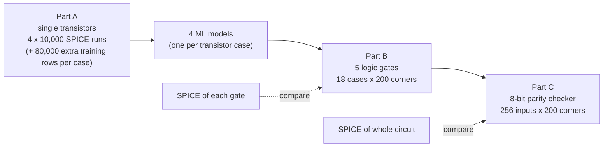
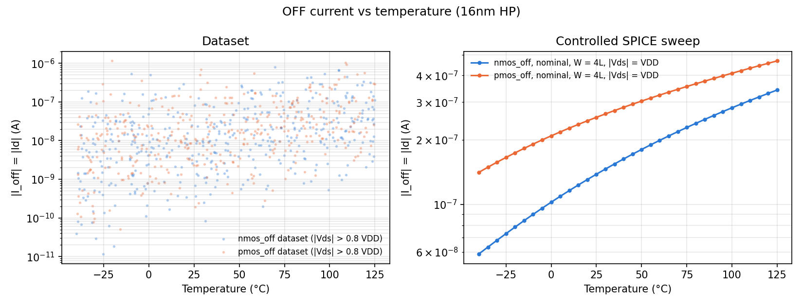
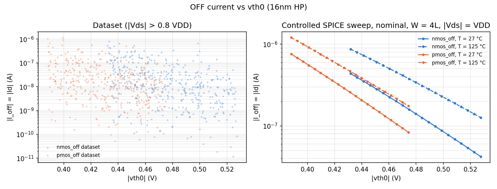
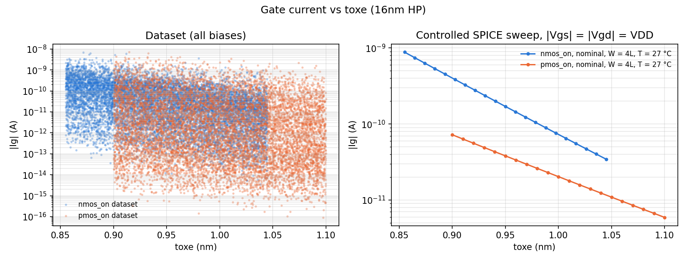
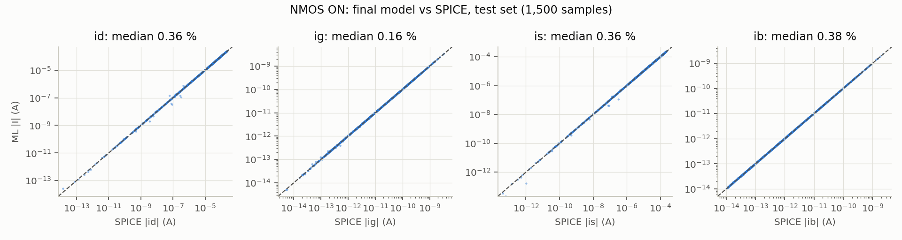
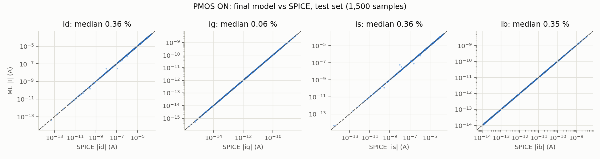
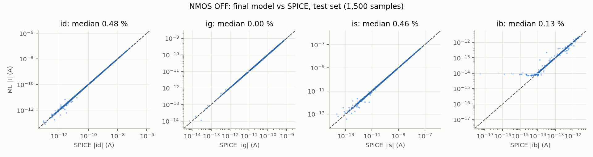
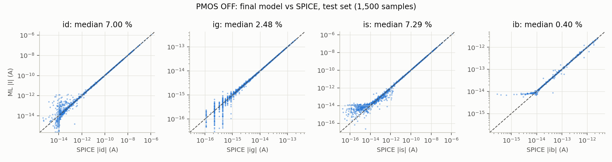
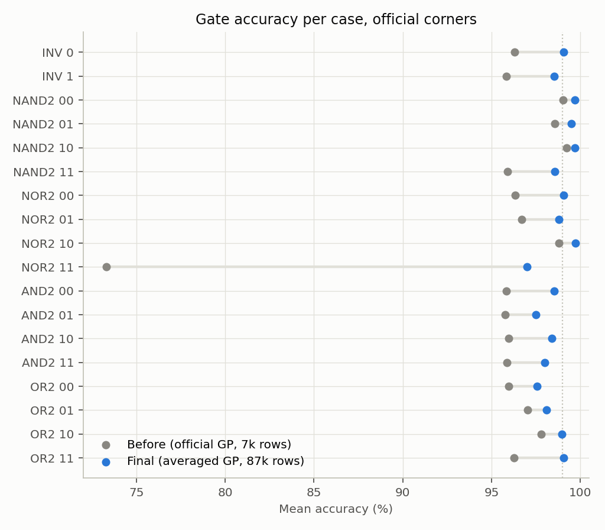
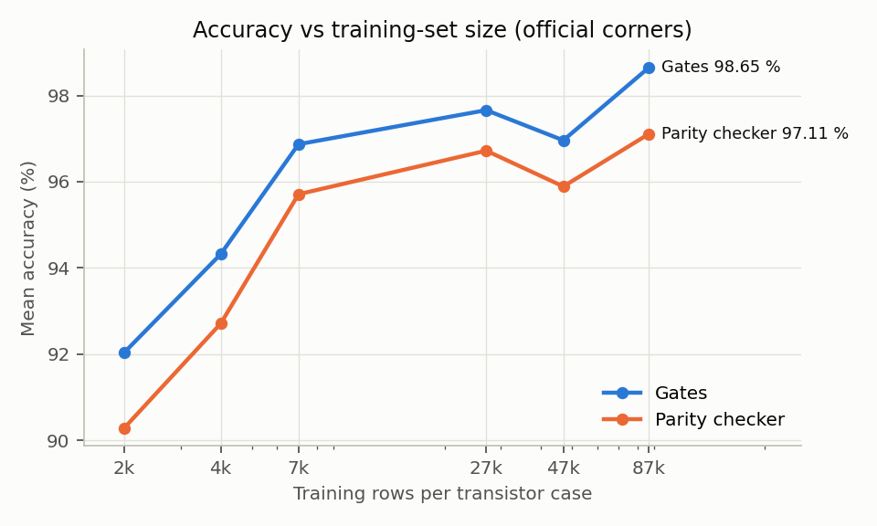

# Project Guide: ML-Driven PVT-Aware Leakage Estimations

This guide explains the whole project in one place:
- what the assignment asked for
- the background you need to follow it
- the final method, step by step
- every final result, with plots and how to read them
- where the remaining errors come from
- how we got here (what was tried, what failed, what fixed it)
- what is still left to do

Read it top to bottom the first time. Later, use the table of contents to jump around.
The step-by-step record of every accuracy experiment is in [`ACCURACY_LOG.md`](ACCURACY_LOG.md).

**Assignment:** 16 nm HP model · VDD = 0.9 V · test circuit = 8-bit parity checker.
**Simulator:** ngspice-36 on Ubuntu 22.04 · Python 3.10 · scikit-learn 1.7.

> **Status (11 Nov 2026).** The final models described here were built and evaluated in
> `exp_acc/` (experiment folder). Moving them into the main scripts (`03`, `06`, `08`) so that
> `run_all.sh` regenerates every deliverable with these numbers is the next step (section 12).
> The files in `results/` and `figures/` (except `figures/final/`) still show the first version.

---

## Contents
1. [The project in one page](#1-the-project-in-one-page)
2. [Background concepts](#2-background-concepts)
3. [What the assignment asks for, and status](#3-what-the-assignment-asks-for-and-status)
4. [Part A1: Transistor data](#4-part-a1-transistor-data)
5. [Part A2: Transistor models](#5-part-a2-transistor-models)
6. [Part B: Logic gates](#6-part-b-logic-gates)
7. [Part C: The 8-bit parity checker](#7-part-c-the-8-bit-parity-checker)
8. [Robustness: fresh data and dataset size](#8-robustness-fresh-data-and-dataset-size)
9. [Where the remaining errors come from](#9-where-the-remaining-errors-come-from)
10. [How we got here](#10-how-we-got-here)
11. [Assumptions and TA clarifications](#11-assumptions-and-ta-clarifications)
12. [What is left to do](#12-what-is-left-to-do)
13. [Repository map and how to rerun](#13-repository-map-and-how-to-rerun)
14. [Glossary](#14-glossary)

---

## 1. The project in one page

**The problem.** A chip draws current even when it is doing nothing; this is **leakage**. In a 16 nm chip, leakage is a large share of total power. It also changes a lot with:
- **P**rocess: tiny manufacturing differences between transistors
- **V**oltage: the supply varies by about ±10 %
- **T**emperature: −40 °C to 125 °C

Together these are called **PVT variation**. The accurate way to measure leakage is **SPICE** circuit simulation, which is slow for large circuits and many PVT conditions.

**The idea.**
1. Run SPICE only on *single transistors*.
2. Train machine-learning (ML) models that predict a transistor's currents.
3. Predict the leakage of *whole circuits* by combining those transistor predictions, with no further SPICE needed.
4. Check every ML prediction against SPICE to see how accurate the idea is.

**Three levels, each built on the one before:**



**Final results at a glance** (accuracy = 100 − mean |error|):

| Level | Median error | Mean accuracy | Bias | On fresh, unseen data |
|---|---|---|---|---|
| Transistor models, currents ≥ 10⁻¹¹ A (the ones that matter for leakage) | **0.14–0.28 %** | – | – | same |
| Transistor models, all currents | 0.06–0.48 % (NMOS ON / NMOS OFF / PMOS ON); PMOS OFF up to 7 % (noise floor) | – | – | same |
| **Gates** (3,600 comparisons) | **0.67 %** | **98.65 %** | −0.23 % | 98.61 % |
| **Parity checker** (51,200 comparisons) | **2.35 %** | **97.11 %** | −2.12 % | 97.14 % |

- 7 of the 18 gate cases are at or above 99 %; the weakest is 97.0 %.
- The parity checker is within 0.3 points of the best the prescribed method can reach on 16 nm HP: summing *exact SPICE* gate leakages already gives only ~97.4 % (section 7.5).
- The target in the project document is "up to 99 % mean accuracy", and the document expects the circuit to be "somewhat lower than at the gate level".

---

## 2. Background concepts

### 2.1 Transistors, ON and OFF
A MOSFET has four terminals: **drain (d), gate (g), source (s) and body (b)**.
- The gate voltage switches the transistor ON (it conducts between d and s) or OFF (it is supposed to block).
- **NMOS** is ON when its gate is at VDD; **PMOS** is ON when its gate is at 0.

The project uses four transistor **cases**. The gate and body voltages are fixed by the case; drain and source are free:

| Case | Gate | Body | Drain, source |
|---|---|---|---|
| NMOS ON | VDD | 0 | random in 0…VDD |
| NMOS OFF | 0 | 0 | random in 0…VDD |
| PMOS ON | 0 | VDD | random in 0…VDD |
| PMOS OFF | VDD | VDD | random in 0…VDD |

Why: in a logic gate every transistor gate is driven to 0 or VDD (so it is clearly ON or OFF), every NMOS body is tied to ground and every PMOS body to VDD, while the drain and source of a stacked transistor can sit anywhere between 0 and VDD.

### 2.2 Where leakage comes from
Even an OFF transistor passes small currents:

| Mechanism | Where it flows | Depends on | In our 16nm HP |
|---|---|---|---|
| **Sub-threshold** (channel) | through the channel of an OFF transistor, high side → low side | exponentially on Vgs − Vth, on temperature, and on Vds | **dominant (~99.9 % of the total)** |
| **Gate tunnelling** | through the ~1 nm gate oxide | oxide thickness, voltage across the oxide | small |
| **Junction / body** | reverse-biased drain/source–body diodes | junction voltage, temperature | ~10⁻¹⁴ A |
| **GIDL** | gate-induced drain leakage at high drain–gate voltage | | small here |

The model file has all of these switched on (`igcmod=1`, `igbmod=1`, `diomod=1`, `agidl`…).

### 2.3 Terminal currents
For each transistor we record four currents, **Id, Ig, Is, Ib**. Charge is conserved, so they always sum to zero (Kirchhoff's current law, **KCL**): `Id + Ig + Is + Ib = 0`.

**Sign convention.** We store the raw ngspice source currents. Positive means current flowing *out* of the transistor terminal. This matches the TA's sample database.

### 2.4 Leakage of a gate or circuit
**Definition used everywhere (SPICE and ML):**

> **Leakage = the total current drawn from everything held at logic 1 = VDD supply current + current drawn by every input held at VDD.**

- This equals the static power divided by VDD.
- Inputs at 1 are included because the gate-tunnelling current entering them is ultimately supplied from VDD by whatever drives them. With this definition, **a circuit's leakage is the sum of its gates' leakages**, which Part C relies on.
- The TA confirmed the definition is ours to choose, as long as SPICE and ML use the same one.

**Example, inverter with input = 1** (output = 0): the OFF PMOS holds the full VDD and passes sub-threshold current from VDD into the output; the ON NMOS carries it to ground; gate tunnelling also flows from the input through the NMOS gate oxide.

### 2.5 Corners
A **corner** is one random PVT condition: one VDD, one temperature, one set of the five process parameters for all NMOS, and another set for all PMOS. We draw **200 corners** once and use the same 200 for every gate and for the parity checker, so all comparisons are like-for-like.

### 2.6 How accuracy is measured
```
error = (ML − SPICE) / SPICE            (relative error, e.g. 0.02 = 2 %)
```

| Metric | Meaning |
|---|---|
| **Median error** | Half of all comparisons are better than this |
| **p95 error** | 95 % of comparisons are better than this (the "bad tail") |
| **Bias** | Median *signed* error. Negative means ML predicts too low on average. |
| **Mean accuracy** | 100 % − average of \|error\| (the project's "mean accuracy"; confirmed with the TA) |
| **R²** | How much of the variation the model explains (1.0 = perfect), computed on log₁₀\|I\| because currents span 13 orders of magnitude |

### 2.7 Parity plots
Most result figures are **parity plots**: SPICE value on the x-axis, ML value on the y-axis, both on log scales. A perfect model puts every point on the dashed diagonal line. Points *above* the line are over-predictions; points *below* are under-predictions.

---

## 3. What the assignment asks for, and status

### 3.1 Our assigned values

| Item | Value |
|---|---|
| Model file | `16nm_HP.pm` (PTM 16 nm high-performance, BSIM4 level 54) |
| Nominal VDD | 0.9 V (sampled 0.81–0.99 V) |
| Channel length | 16 nm |
| Widths | 16–128 nm (1–8 × Lmin) |
| Temperature | −40 to 125 °C |
| Process parameters | vth0, toxe, ndep, u0, xj, each nominal ±10 % |
| Test circuit | 8-bit parity checker |

Nominal process parameters from the model file:

| Parameter | NMOS | PMOS | Meaning |
|---|---|---|---|
| vth0 | 0.47965 V | −0.43121 V | threshold voltage |
| toxe | 0.95 nm | 1.0 nm | gate oxide thickness |
| ndep | 7.0×10¹⁸ | 5.5×10¹⁸ | channel doping |
| u0 | 0.03 | 0.006 | mobility |
| xj | 5 nm | 5 nm | junction depth |

### 3.2 Deliverables checklist

| # | Deliverable (from the spec) | Where | Status |
|---|---|---|---|
| 1 | 4 datasets × 10,000 rows, exact columns | `data/*.csv` | ✅ (extra training rows are separate files) |
| 2 | Example netlists: 4 transistor, 5 gate, 1 circuit | `netlists/` | ✅ |
| 3 | KCL check + 3 trend plots | `results/kcl_check.csv`, `figures/trend_*.png` | ✅ |
| 4 | Model comparison: 4 model types × 4 cases (R², median, p95, validation) | `results/model_comparison_val.csv` + section 5.5 | ✅ (final model row to be added in the pipeline) |
| 5 | Chosen models: test errors, predicted-vs-SPICE plots, 4 model files | section 5.6, `figures/final/pred_vs_spice_*.png`, `exp_acc/out/models/` | ✅ final results; ⏳ move into `models_trained/` |
| 6 | Gate results table (18 cases) | section 6.5, `exp_acc/out/round2_gate_results_GPX.csv` | ✅ final results; ⏳ regenerate in `results/` |
| 7 | Gate parity plot | `figures/final/gate_parity.png` | ⏳ being generated |
| 8 | Test-circuit results + parity plot | section 7.4, `figures/final/circuit_parity.png` | ✅ results; ⏳ plot being generated |
| 9 | Code that regenerates everything, fixed seeds | `run_all.sh` + `01_…08_*.py` (+ `exp_acc/`) | ⏳ final models must be moved into the main scripts |
| 10 | Typed report | – | ⏳ **not written yet** |

Every netlist contains the required `.options gmin=1e-18 abstol=1e-18 reltol=1e-6 vntol=1e-9`, and every single-transistor netlist has one voltage source per terminal.

---

## 4. Part A1: Transistor data

### 4.1 The 10,000-sample datasets
For each of the 4 cases we created **10,000 random samples**. Each sample is drawn in this order, all uniform and independent:
1. VDD in 0.81–0.99 V (nominal 0.9 V ± 10 %; first, because the next ranges depend on it)
2. drain voltage Vd and source voltage Vs, each in 0…VDD
3. width W in 16–128 nm, and temperature in −40…125 °C
4. the 5 process parameters, each nominal ±10 %

Gate and body voltages are fixed by the case (table in 2.1). Each sample becomes its own SPICE netlist: the model card with that sample's parameter values substituted, one voltage source per terminal, and the required options. Example: [`netlists/nmos_on_example.cir`](netlists/nmos_on_example.cir).

One ngspice process runs hundreds of circuits back to back, with 4 processes in parallel; 10,000 simulations take about 30 s. No simulation failed.

**Split:** 70 % training (7,000), 15 % validation (1,500), 15 % test (1,500), fixed seed 42.

### 4.2 Extra training data
The document allows more samples ("the number of samples may be increased or decreased as needed"). We generated **80,000 extra training rows per case** with exactly the same generator, distributions, model card and options; only the random seeds differ (5001–5304 and 7001–7304, disjoint from every other seed).
- The final models train on **87,000 rows per case** (the 7,000-row training split + 80,000 extra).
- **Validation and test are always the original 1,500 rows each**, so all reported numbers are on data the models never saw.
- Section 8.2 shows how accuracy grows with the number of rows.

### 4.3 Data check 1: Kirchhoff's law
The four currents must sum to zero. We checked every one of the 360,000 samples (original + extra):

| Case | Worst \|Id+Ig+Is+Ib\| | Median |
|---|---|---|
| NMOS ON | 1.0×10⁻¹⁴ A | 2×10⁻¹⁶ A |
| NMOS OFF | 4.7×10⁻¹⁷ A | 5×10⁻²² A |
| PMOS ON | 1.0×10⁻¹⁴ A | 7×10⁻¹⁷ A |
| PMOS OFF | 1.4×10⁻¹⁵ A | 8×10⁻¹⁷ A |

All residuals are at ngspice's numerical resolution (steps of ~2×10⁻¹⁶ A); relative to any current above 10 pA they are below 0.08 %.

Further checks (all passed): every parameter inside its range, Vg/Vb exactly as the case requires, no duplicate rows, original and extra data from the same distribution (KS test, all p > 0.05), and re-simulating random rows reproduces the stored currents to better than 2×10⁻⁸ (relative, above 1 pA).

### 4.4 Data check 2: trend plots
Each figure has two panels. The **left panel** is the random dataset (noisy, because every other parameter also varies). The **right panel** is a clean SPICE sweep with everything at nominal, so the trend itself is visible.

**OFF current vs temperature**



OFF current rises steadily with temperature: about 6× for NMOS and 3× for PMOS from −40 to 125 °C, because the sub-threshold current depends exponentially on kT/q and the threshold voltage falls with temperature.

**OFF current vs threshold voltage vth0**



On a log scale the lines are straight: the OFF current falls **exponentially** as |vth0| rises, roughly 10× per 0.1 V (textbook sub-threshold behaviour, I ∝ exp(−Vth / (n·kT/q))).

**Gate current vs oxide thickness toxe**



The gate current falls exponentially as the oxide gets thicker (tunnelling through a thinner barrier is exponentially easier). NMOS gate current is about 10× larger than PMOS.

All three trends match device physics, so the data can be trusted for training.

---

## 5. Part A2: Transistor models

### 5.1 The task
For each case, learn a function:

```
(VDD, T, W, Vd, Vs, Vg, Vb, vth0, toxe, ndep, u0, xj)  →  (Id, Ig, Is, Ib)
```

The training set fits the models, the validation set chooses between model types and settings, and the test set is only used at the very end to report accuracy on data never seen before.

### 5.2 Why this is hard
1. **Huge range.** Currents span about **13 orders of magnitude** (10⁻¹⁷ to 10⁻⁴ A).
2. **Sign changes.** Some currents change sign depending on the voltages.
3. **Several mechanisms at once**, and which one dominates changes with the voltages.

### 5.3 How the final model works, step by step

```
inputs ─► hi/lo frame ─► physics features ─► straight line + GP (average of 9) ─► ln(|I|/W)
                                                        │
                    Id, Ig, Is, Ib ◄── back to amperes ◄┴── 4th current from KCL
```

| Step | What it does | Why |
|---|---|---|
| 1. **Symmetric "hi/lo" frame** | Call the higher of (Vd, Vs) "hi" and the lower "lo" | A MOSFET is source/drain symmetric. In this frame the channel current always flows the same way, so the model never learns the same physics twice. |
| 2. **Log target** | Predict ln(\|I\| / W) instead of I | Turns 13 decades into a gentle surface. An error of 0.01 in the log is ~1 % in current, at any size. Dividing by W removes the simple width scaling. |
| 3. **Physics features** | Voltages divided by kT/q (Vgs/Vt, Vgd/Vt, Vds/Vt, \|vth0\|/Vt, 1/Vt), the drain factor ln(1−e^(−Vds/Vt)), log W, the 5 process values. **ON cases also get the plain voltages Vgs, Vgd, Vds.** | These are the variables of the sub-threshold current equation, so log-current becomes almost linear in them. Gate tunnelling depends on the oxide voltage, not on kT/q; the plain voltages let the ON models get the gate current right at every temperature (section 10). |
| 4. **Straight line + Gaussian process** | A linear fit captures the main trend; a GP learns the remaining smooth correction | The GP predicts a new point as a weighted blend of nearby training points, with a separate "nearness" scale per input (ARD RBF kernel). It is near-exact for smooth, noise-free data like SPICE output. |
| 5. **Averaged GP (use all 87,000 rows)** | Kernel settings fitted once per current (on 2,000 points); the 87,000 rows split into 9 slices of ~9,700; one exact GP per slice; predictions averaged | An exact GP's cost grows as n³ (87,000 rows at once would need ~60 GB). Averaging slice GPs uses every row and also reduces the model's sensitivity to which rows it saw. |
| 6. **Two experts for OFF devices** | Separate models for the "channel-dominated" and "junction/gate-dominated" regimes; the split point is found from the training data (30 % of VDD for PMOS, 12.5 % for NMOS) | The change-over between regimes is a sharp bend that one smooth model cannot follow. |
| 7. **Noise floor** | Currents below 3×10⁻¹⁵ A are left out of the GP training for that current | Below that, SPICE values are partly numerical noise. |
| 8. **KCL for the mixed-sign current** | The one current that can change sign is computed as −(sum of the other three) | No zero crossing to learn, and every prediction satisfies KCL exactly. |
| 9. **Clamp** | ln(1−e^(−Vds/Vt)) is limited at Vds = 2 mV | It heads to −∞ as Vds → 0; ON transistors in gates sit at µV–mV. |

### 5.4 The four model types compared
| Model type | Main settings |
|---|---|
| **Polynomial ridge regression** | degree-3 polynomial of the inputs, ridge penalty 10⁻⁴ |
| **LightGBM** (gradient-boosted trees) | 5,000 trees, learning rate 0.02, 15 leaves |
| **MLP** (neural network) | 3 hidden layers × 64 tanh units, Adam, early stopping |
| **Gaussian process (GP)** | ARD RBF kernel + linear mean; settings tuned on 2,000 points, then exact GP on all training points |

### 5.5 Model comparison table (validation set, deliverable 4)
Median relative error (%) per terminal current, and the average of the four. All four types use the same features and 7,000 training rows (the document's setting):

| Case | Model | Id | Ig | Is | Ib | **Avg** |
|---|---|---|---|---|---|---|
| NMOS ON | Poly ridge | 12.3 | 7.0 | 12.3 | 13.1 | 11.2 |
| | LightGBM | 3.6 | 5.8 | 3.6 | 8.6 | 5.4 |
| | MLP | 2.8 | 3.6 | 2.9 | 3.1 | 3.1 |
| | **GP** | **0.52** | **0.37** | **0.50** | **0.49** | **0.47** |
| NMOS OFF | Poly ridge | 28.6 | 1.1 | 26.4 | 21.1 | 19.3 |
| | LightGBM | 9.0 | 3.3 | 9.0 | 1.1 | 5.6 |
| | MLP | 3.5 | 1.6 | 3.5 | 1.7 | 2.6 |
| | **GP** | **0.66** | **0.00** | **0.62** | **0.18** | **0.37** |
| PMOS ON | Poly ridge | 10.6 | 10.7 | 10.6 | 13.6 | 11.4 |
| | LightGBM | 3.4 | 10.3 | 3.4 | 9.1 | 6.5 |
| | MLP | 5.5 | 2.8 | 5.5 | 3.2 | 4.3 |
| | **GP** | **0.54** | **0.10** | **0.52** | **0.42** | **0.40** |
| PMOS OFF | Poly ridge | 14.4 | 51.9 | 16.2 | 20.1 | 25.6 |
| | LightGBM | 19.1 | 35.0 | 19.5 | 1.4 | 18.8 |
| | MLP | 16.2 | 20.2 | 17.4 | 5.2 | 14.8 |
| | **GP** | **9.6** | **2.6** | **9.7** | **0.50** | **5.6** |

The full table, including R² and p95, is in `results/model_comparison_val.csv`.

**With all 87,000 rows** we compared the averaged GP against a stronger neural-network setup (3 seeds × one 3 × 128 tanh network per current on a linear fit's residual, up to 4,000 epochs) and their average. Validation, average of the four medians:

| Case | Averaged GP (final) | MLP ensemble | GP + MLP average |
|---|---|---|---|
| NMOS ON | **0.31 %** | 0.72 % | 0.43 % |
| NMOS OFF | 0.26 % | 0.38 % | **0.25 %** |
| PMOS ON | **0.27 %** | 0.70 % | 0.40 % |
| PMOS OFF | **3.9 %** | 6.4 % | 5.1 % |

**Why the GP was chosen.** It is the most accurate type in every case at both data sizes (2–10× better than the next best), and transistor currents are smooth, noise-free functions, which is exactly what a GP fits best. The choice is made on the transistor validation split only.

### 5.6 Final models on the test set (deliverable 5)

Median error per current, test set (1,500 samples per case):

| Case | Id | Ig | Is | Ib | Worst-current R² (log) | Currents ≥ 10⁻¹¹ A: median / p95 |
|---|---|---|---|---|---|---|
| NMOS ON | 0.36 % | 0.16 % | 0.36 % | 0.38 % | 1.000 | **0.26 % / 1.8 %** |
| NMOS OFF | 0.48 % | 0.00 % | 0.46 % | 0.13 % | 0.971 | **0.14 % / 2.3 %** |
| PMOS ON | 0.36 % | 0.06 % | 0.36 % | 0.35 % | 1.000 | **0.27 % / 1.6 %** |
| PMOS OFF | 7.0 % | 3.1 % | 7.3 % | 0.40 % | 0.948 | **0.28 % / 3.3 %** |

**How to read the PMOS OFF row.** About two-thirds of PMOS OFF current values are ~10⁻¹⁴ A, where SPICE's own numerical resolution is a few percent; no model can predict that noise. Those currents are more than 1,000× smaller than any gate leakage (≥ 3×10⁻¹¹ A). On the currents that matter, **all four models are below 0.3 % median error**, which meets the TA's "error < 1 %" target. The NMOS OFF R² is pulled down the same way by ~10⁻¹⁴ A body currents.

### 5.7 Predicted-vs-SPICE plots (test set)
Each figure has 4 panels (Id, Ig, Is, Ib); every dot is one test sample.

**NMOS ON**: every current sits tightly on the diagonal across all decades.



**PMOS ON**: equally tight.



**NMOS OFF**: Id, Is and Ig sit on the line from 10⁻¹³ to 10⁻⁶ A. Ib flattens out around 10⁻¹⁴ A; below that, SPICE's own values are noise, so the model predicts the floor.



**PMOS OFF**: above ~10⁻¹² A every panel is on the line; that is the range gates use (10⁻¹⁰ to 10⁻⁶ A). The scatter is entirely below ~10⁻¹³ A, at the junction/noise floor. In the Ig panel the SPICE values form vertical stripes at exact multiples of ~2×10⁻¹⁶ A: ngspice's resolution steps.



---

## 6. Part B: Logic gates

### 6.1 The gates
Standard static CMOS gates. AND2 = NAND2 + INV and OR2 = NOR2 + INV, each simulated as one complete gate.

| Gate | Inputs | Internal node(s) |
|---|---|---|
| INV | A = 0, 1 | – |
| NAND2 | AB = 00, 01, 10, 11 | x (between the two series NMOS) |
| NOR2 | AB = 00, 01, 10, 11 | y (between the two series PMOS) |
| AND2 | AB = 00…11 | x, and the NAND output nd |
| OR2 | AB = 00…11 | y, and the NOR output nr |

**18 gate/input cases × 200 corners = 3,600 SPICE simulations**, plus the same 3,600 ML predictions.

**Transistor sizes** follow the TA's AND2 example (INV PMOS = 2 × NMOS, stacked transistors 2×), with unit width **24 nm** (1.5 × Lmin), so every transistor (24–96 nm) lies inside the trained width range:

| Gate | NMOS width | PMOS width |
|---|---|---|
| INV | 24 nm | 48 nm |
| NAND2 | 48 nm (series) | 48 nm (parallel) |
| NOR2 | 24 nm (parallel) | 96 nm (series) |

Example netlist: [`netlists/gate_NAND2.cir`](netlists/gate_NAND2.cir).

### 6.2 SPICE reference
- Inputs are ideal sources at exactly 0 or VDD.
- Leakage as defined in 2.4: `I_leak = −( I(Vdd) + Σ I(V_input) for inputs held at 1 )`.
- Sanity check: the current returning through ground agrees with the supply side within 2×10⁻⁵ (relative). Every output sits at its correct logic level.

### 6.3 ML prediction: from transistor models to gate leakage
1. **Node voltages.** Each transistor's terminal voltages come from the gate's node voltages (output, x, y, nd, nr), in two versions (the TA asked for both):
   - **Version A (prescribed by the document):** the node voltages recorded in the gate's SPICE simulation.
   - **Version B (fully ML):** node voltages predicted with the transistor models, no SPICE input (section 6.6).
2. **Currents.** Each transistor's gate level selects its ON or OFF model, which predicts its four terminal currents.
3. **Adding them up: the cut-set method** (Kirchhoff's law):
   1. Split all nodes into a **logic-1 group** (VDD rail, inputs at 1, nodes at 1) and a **logic-0 group**.
   2. The leakage equals the net current flowing from the logic-1 group into the logic-0 group.
   3. A transistor with drain and source in the **same** group (every ON transistor) can only pass current across the split through its **gate and body**, so only Ig and Ib are used. This avoids the ON transistor's channel current at µV, which is tiny and hard to predict.
   4. A transistor with drain and source in **different** groups (an OFF transistor holding the voltage) contributes its currents on the logic-1 side.

**Example: inverter with input A = 1** (output ≈ 0):
- **PMOS** (gate 1, source VDD, drain ≈ 0) is **OFF** and straddles the split: it contributes its sub-threshold leakage, about 2×10⁻⁷ A.
- **NMOS** (gate 1, drain ≈ 0, source 0) is **ON**, both ends in the logic-0 group: it contributes only its gate current (input → channel), about 5×10⁻¹¹ A.

This is the TA's slide formula "leakage = I_sub + I_gate + I_body" in exact KCL form.

**Floating stack nodes.** When two stacked transistors are both OFF (NAND2 `00`, NOR2 `11`), the node between them floats at an in-between voltage. Either side of the split is exact by KCL. We put it on the output's side, so the transistor connected to the supply rail is the one crossing the split (the regime the models predict best). Putting it on the other side, or averaging both, changes the results by less than 0.1 %.

### 6.4 Gate results, version A (deliverable 6)
SPICE node voltages; official 200 corners; fresh-corner accuracy from section 8.1:

| Gate | Input | SPICE median | Bias | Median error | p95 error | **Accuracy** | Accuracy, fresh corners |
|---|---|---|---|---|---|---|---|
| INV | 0 | 5.01e-08 A | −0.60 % | 0.78 % | 2.2 % | **99.05 %** | 98.9 % |
| INV | 1 | 1.95e-07 A | +0.07 % | 0.67 % | 5.6 % | 98.52 % | 98.5 % |
| NAND2 | 00 | 5.60e-10 A | +0.19 % | 0.24 % | 0.9 % | **99.69 %** | 99.7 % |
| NAND2 | 01 | 1.14e-07 A | −0.09 % | 0.32 % | 1.6 % | **99.48 %** | 99.4 % |
| NAND2 | 10 | 1.72e-08 A | +0.22 % | 0.27 % | 0.8 % | **99.69 %** | 99.8 % |
| NAND2 | 11 | 3.83e-07 A | +0.07 % | 0.65 % | 5.5 % | 98.55 % | 98.5 % |
| NOR2 | 00 | 9.98e-08 A | −0.59 % | 0.78 % | 2.2 % | **99.05 %** | 98.9 % |
| NOR2 | 01 | 3.90e-07 A | +0.07 % | 0.51 % | 4.5 % | 98.79 % | 98.7 % |
| NOR2 | 10 | 3.65e-08 A | +0.02 % | 0.19 % | 0.7 % | **99.72 %** | 99.7 % |
| NOR2 | 11 | 6.22e-10 A | +0.89 % | 0.90 % | 13.6 % | 96.99 % | 97.4 % |
| AND2 | 00 | 1.96e-07 A | +0.06 % | 0.64 % | 5.6 % | 98.53 % | 98.5 % |
| AND2 | 01 | 3.63e-07 A | −1.79 % | 1.92 % | 6.3 % | 97.49 % | 97.5 % |
| AND2 | 10 | 2.18e-07 A | −0.35 % | 0.87 % | 5.3 % | 98.40 % | 98.3 % |
| AND2 | 11 | 4.61e-07 A | −1.21 % | 1.39 % | 5.6 % | 97.99 % | 97.9 % |
| OR2 | 00 | 3.46e-07 A | −1.74 % | 2.01 % | 6.4 % | 97.58 % | 97.5 % |
| OR2 | 01 | 4.65e-07 A | −1.18 % | 1.33 % | 5.4 % | 98.09 % | 97.9 % |
| OR2 | 10 | 1.09e-07 A | −0.92 % | 0.92 % | 2.2 % | 98.96 % | 98.9 % |
| OR2 | 11 | 5.23e-08 A | −0.58 % | 0.75 % | 2.2 % | **99.07 %** | 98.9 % |
| **All** | | 1.22e-07 A | **−0.23 %** | **0.67 %** | **4.9 %** | **98.65 %** | **98.61 %** |

**How to read it:**
- **≥ 99 % (7 cases):** all NAND2 inputs except `11`, NOR2 `00` and `10`, INV `0`, OR2 `11`. The leakage there is carried by transistors whose operating points are well covered by the training data.
- **98–99 % (7 cases):** INV `1`, NAND2 `11`, AND2 `00`/`10`, NOR2 `01`, OR2 `10`/`01`. Most contain an OFF PMOS holding the full supply (source at VDD, drain at 0), a sparsely sampled corner of the PMOS OFF input space.
- **Below 98 % (4 cases):** AND2 `01`/`11` and OR2 `00` carry a −1.2 to −1.8 % bias from the node between their two stages (section 9.2); NOR2 `11` has a tiny leakage (6×10⁻¹⁰ A) dominated by ON-NMOS gate current, with a wide tail.
- **Pattern dependence:** leakage varies about 700× with the input pattern (NAND2 `00` vs `11`): the classic **stacking effect**. Two OFF transistors in series leak far less than one, because the middle node rises and reverse-biases the upper transistor. Both SPICE and ML capture it.
- Every case gives almost the same accuracy on the fresh corners, so the results are stable.



The figure shows each gate case's accuracy with the first models (gray) and the final models (blue); the dotted line is 99 %.

### 6.5 Gate parity plot (deliverable 7)
*Being generated together with the version B results; it will be added here as `figures/final/gate_parity.png`.*

### 6.6 Version B: ML-predicted node voltages (TA request)
**Method.** No SPICE information is used:
1. Every node starts at its logic level (0 or VDD; VDD/2 for a stack node between two OFF transistors).
2. Each node voltage is solved from KCL with the four transistor models: bisection on [0, VDD] for the voltage where the predicted currents into the node sum to zero, repeated over all nodes (Gauss–Seidel) until no node moves by more than 0.1 µV.
3. The gate leakage is computed from those voltages with the same cut-set rule as version A.

**First observations** (3-corner trial run):
- **Floating stack nodes are predicted within ~1 mV:** NAND2 `00` node x 0.1663 V (SPICE) vs 0.1659 V (ML); NOR2 `11` node y 0.7786 V vs 0.7789 V.
- **Nodes driven to a rail come out exactly at the rail**, while SPICE puts them 1–8 mV away from it. The ON transistor's channel current below ~2 mV across it is not resolved by the models (few training rows there, and the drain-factor input is clamped at 2 mV), so the ML solution behaves like an ideal switch. The voltage error is under 1 % of VDD.

**Full results:** *being computed (official 200 and fresh 100 corners); the table of version A vs version B per gate case, the node-voltage errors in mV and the parity results will be added here.*

---

## 7. Part C: The 8-bit parity checker

### 7.1 The circuit
- An 8-bit parity checker outputs 1 when an **odd** number of its 8 inputs is 1: P = D0 ⊕ D1 ⊕ … ⊕ D7.
- It is a balanced tree of **7 XOR gates** (4 → 2 → 1), each built from **4 NAND2** (the TA confirmed any structure is fine as long as the leakage is built from the basic gates):

  ```
  n1 = NAND(a, b);   n2 = NAND(a, n1);   n3 = NAND(b, n1);   out = NAND(n2, n3)
  ```

- In total: **28 NAND2 gates, 112 transistors**; 2⁸ = **256 input vectors** × 200 corners = **51,200 SPICE simulations**. Netlist: [`netlists/parity8.cir`](netlists/parity8.cir).

### 7.2 SPICE reference
One complete transistor-level netlist per corner, all 256 input vectors applied in turn.
- No failures and no logic errors: in all 51,200 runs the output had the correct parity.
- Supply and ground currents agree within 10⁻⁷ (relative).
- Leakage: median 5.4 µA, ranging from 0.44 to 31 µA depending on corner and input.

### 7.3 ML prediction (hierarchical, as prescribed)
For each input vector:
1. A **logic simulation** finds the two inputs of each of the 28 NAND2 gates.
2. For each NAND2, take its **Part B ML leakage** for that pattern at that corner.
3. **Add the 28 values.**

### 7.4 Results (deliverable 8)

| Circuit | n | SPICE median | Bias | Median error | p95 error | **Accuracy** | Fresh corners |
|---|---|---|---|---|---|---|---|
| 8-bit parity (version A) | 51,200 | 5.38 µA | **−2.12 %** | **2.35 %** | **7.4 %** | **97.11 %** | 97.14 % |

*The parity plot (`figures/final/circuit_parity.png`) and the version B result will be added with the version B run.*

### 7.5 Why the circuit is below the gates: the composition limit
The prescribed method assumes every gate input is at exactly 0 or VDD and ignores loading between gates; the document itself says to "expect the accuracy to be somewhat lower than at the gate level". We measured how much this costs, **with SPICE alone**:

| | Official corners | Fresh corners |
|---|---|---|
| Sum of the 28 *SPICE* NAND2 leakages vs SPICE of the full circuit: bias | −2.15 % | −1.79 % |
| Best accuracy the summation method can reach | ~97.4 % | 97.71 % |
| Our ML result | 97.11 % (bias −2.12 %) | 97.14 % (bias −1.92 %) |

The ML bias is almost exactly the composition bias, so **almost all of the remaining parity error comes from the method, not from the ML models**.

**Physical reason.** Inside the circuit, a logic 1 produced by another gate sits slightly *below* VDD, because leakage flows through the driving gate's ON PMOS. An OFF PMOS whose gate receives that slightly-low "1" is not fully off, and its leakage rises exponentially with the gap. The gap grows with temperature (more leakage), so the under-estimate is largest at hot corners. 16nm HP makes this effect large because it is the leakiest of all the course model cards (section 9.4).

---

## 8. Robustness: fresh data and dataset size

### 8.1 Fresh independent check
To make sure the results are not tuned to the official data, the final pipeline was scored once on data **never used anywhere before**: 2,000 new transistor samples per case (seeds 9000–9003), **100 new corners** (seed 9999), 1,800 gate and 25,600 parity SPICE simulations (0 failures, 0 logic errors). Nothing was tuned or chosen on this data.

| | Official data | **Fresh data** |
|---|---|---|
| Transistors, median error (all four cases, currents ≥ 10⁻¹¹ A) | 0.14–0.28 % | 0.15–0.26 % |
| Gates: accuracy / median / p95 | 98.65 % / 0.67 % / 4.9 % | **98.61 % / 0.71 % / 5.7 %** |
| Parity: accuracy / median / bias | 97.11 % / 2.35 % / −2.12 % | **97.14 % / 2.14 % / −1.92 %** |

The results reproduce on unseen data.

### 8.2 Dataset size
The document asks for high accuracy "preferably with the smallest dataset possible". The final model type trained on increasing numbers of rows per case:

| Training rows per case | 2,000 | 4,000 | 7,000 | 27,000 | 47,000 | **87,000** |
|---|---|---|---|---|---|---|
| Transistors, validation (NMOS ON / NMOS OFF / PMOS ON / PMOS OFF) | 0.67 / 0.76 / 0.52 / 6.9 % | 0.51 / 0.49 / 0.38 / 6.8 % | 0.41 / 0.36 / 0.33 / 5.7 % | 0.32 / 0.27 / 0.28 / 5.1 % | 0.30 / 0.29 / 0.27 / 4.0 % | 0.31 / 0.26 / 0.27 / 3.9 % |
| Gates | 92.0 % | 94.3 % | 96.9 % | 97.7 % | 97.0 % | **98.65 %** |
| Parity checker | 90.3 % | 92.7 % | 95.7 % | 96.7 % | 95.9 % | **97.11 %** |



- Transistor accuracy improves steadily up to ~27,000 rows and then flattens.
- Gate accuracy keeps improving up to 87,000 rows. Gates rely on a few rare operating points (e.g. an OFF PMOS holding the full supply), and those need many random samples to be covered well. The dip at 47,000 rows is exactly that: with those rows the PMOS OFF model happened to fit that point less well (INV `1`, NAND2 `11`, AND2 `00` dropped to ~94.8 %).
- 87,000 rows is the smallest tested size that reaches ~98.6 %.

---

## 9. Where the remaining errors come from

### 9.1 By transistor case
All four models are below 0.3 % median error on the currents that matter. PMOS OFF has the largest overall numbers because most of its random samples fall into the junction/noise floor: its channel current collapses about 10× per 50 mV as the source moves away from VDD.

### 9.2 By gate and input
- **Two-stage gates (AND2 `01`/`11`, OR2 `00`/`01`): bias −1.2 to −1.8 %.** The INV stage's gate is driven by the internal node nd / nr, which in SPICE is slightly off the rail. The transistor models only accept a gate voltage of exactly 0 or VDD (the document's case definition), so the INV stage is modelled as slightly "more off" than it is. This is the same mechanism as the parity composition error, inside one gate.
- **NOR2 `11` (97.0 %).** At cold corners the PMOS stack barely leaks, so the gate current of the two ON NMOS (with 0 V across them) is almost the whole leakage. That operating point is rare in the training data; the plain-voltage features fixed most of the error (74 % → 97 %), but it remains the hardest case.
- **OFF PMOS holding the full supply (INV `1`, NAND2 `11`, AND2 `00`): 98.5 %.** Sparse corner of the PMOS OFF input space (section 8.2).

### 9.3 By corner condition
*The plot of bias vs temperature for gates and the parity checker (`figures/final/error_vs_temperature.png`) will be added with the version B run.* With the first models, the parity under-estimate grew from −1.5 % (cold) to −6.4 % (hot) while gates barely changed; the composition effect (7.5) explains this growth.

### 9.4 Why 16nm HP is hard
A single NMOS and PMOS simulated for **every model card in the course set**, at VDD = 0.9 V, nominal parameters, L = node size, leakage per µm of width:

| Card | Leakage at 25 °C (nA/µm) | at 125 °C | Share from gate current |
|---|---|---|---|
| **16nm_HP (ours)** | **6,850** | **14,100** | **0.07 %** |
| 22nm_MGK | 2,670 | 7,450 | 56 % |
| 32nm_MGK | 1,530 | 4,480 | 57 % |
| 45nm_MGK | 906 | 2,800 | 55 % |
| 22nm_HP | 548 | 1,810 | 0.2 % |
| 32nm_HP | 69 | 341 | 1.5 % |
| 45nm_HP | 18 | 110 | 9 % |
| 16nm_LP | 7.3 | 9.4 | 99 % |
| 22nm_LP | 1.1 | 1.9 | 97 % |
| 32nm_LP | 0.27 | 1.2 | 84 % |
| 45nm_LP | 0.06 | 0.7 | 53 % |

16nm HP is the **leakiest card** (2.6× the next) and almost purely sub-threshold. That causes:
1. **The composition limit** in the circuit: the more leakage, the further internal logic levels sag.
2. **The noise floor** in the OFF cases: with almost no gate current, a pinched-off channel leaves only ~10⁻¹⁴ A, where SPICE itself is noisy.

---

## 10. How we got here
How the final method was reached, step by step. Useful for the report's "Models" and "Limitations and improvements" sections and for a viva. Full details and per-case tables: [`ACCURACY_LOG.md`](ACCURACY_LOG.md).

### 10.1 Building the first working models
| Stage | Symptom | Root cause | Fix | Effect |
|---|---|---|---|---|
| 1 | First models 10–60 % error | Learning signed currents directly, including zero crossings | Log target, hi/lo frame, mixed-sign current from KCL | Large improvement |
| 2 | Trees / MLP stuck at 3–5 % | A sum of exponentials in different variables is hard for those models | Gaussian process with physics inputs | NMOS OFF hardest current 4.2 % → 0.54 % |
| 3 | PMOS OFF 14 %; gates 14 % low | One smooth GP fitting two regimes | Ignore sub-noise currents; two experts with an automatic split | PMOS OFF at the gate point: −18 % → +0.2 % bias |
| 4 | NOR2 `11` +61 % | ln(1−e^(−Vds/Vt)) → −∞ for ON transistors at µV Vds | Clamp that input at 2 mV | NOR2 `11` → 2.9 % median |
| | | | | **First version: gates 95.58 %, parity 95.33 %** |

### 10.2 Raising the accuracy
| Step | What changed | Gates | Parity | NOR2 `11` |
|---|---|---|---|---|
| First version | GP on 7,000 rows | 95.58 % | 95.33 % | 73.3 % |
| More data | GP on 9,000 rows drawn from 47,000 of our own rows | 97.68 % | 96.86 % | 89.2 % |
| All the data | 87,000 rows, averaged GP (9 slices) | 97.37 % | 97.11 % | 74.4 % |
| **Plain-voltage features (final)** | Vgs, Vgd, Vds added for the ON models | **98.65 %** | **97.11 %** | **97.0 %** |

Also tried, and not adopted:
- **Neural networks** (3 seeds × per-current 3 × 128 networks, 4,000 epochs) on 87,000 rows: less accurate than the GP for every transistor case (section 5.5).
- **GP + MLP averages:** gates 98.34 % (all cases) and 98.68–98.72 % (ON cases only); the gain over the GP alone is below the corner-to-corner noise, and the GP is better on the transistor validation split.
- **Other cut choices for floating nodes:** < 0.1 % difference.

**How the problems were found.** Each transistor model was tested **exactly at the voltages it sees inside the gates**, against fresh single-transistor SPICE runs, and gate cases were re-evaluated with one transistor model swapped at a time. This pinpointed, for example, that NOR2 `11`'s error came only from the NMOS ON gate current at Vds = 0 V at cold corners (~100 % error before the plain-voltage features, 7 % after).

---

## 11. Assumptions and TA clarifications

| # | Topic | Our choice | TA |
|---|---|---|---|
| 1 | Transistor widths | Data: W = 1–8 × Lmin. Gates: 24 nm unit; INV 1/2, NAND2 2/2, NOR2 1/4 units | "Vary the widths, like 8 × Lmin" (done in the data) |
| 2 | Leakage definition | Current from VDD **plus** inputs held at 1 | "You decide" (same in SPICE and ML) |
| 3 | Accuracy | 100 % − mean \|relative error\|; bias reported separately | Compare with the original SPICE result; report bias |
| 4 | Parity structure | 7 XOR2 from 4 NAND2 each, odd parity, no output inverter | "Any way, but built from the basic gates" |
| 5 | Internal node voltages | Version A (SPICE) and version B (ML-predicted) | "Report both" |
| 6 | Current sign | Raw ngspice source currents (positive = out of the device), as in the TA sample | – |
| 7 | Process variation | Only the 5 listed parameters vary; related ones (e.g. toxm) stay nominal | – |
| 8 | Corners | One NMOS draw and one PMOS draw per corner, shared by all transistors | as in the document |
| 9 | Gate inputs | Ideal sources at 0 / VDD; no output load | as in the document |
| 10 | Extra data | 80,000 extra training rows per case (own seeds); validation/test unchanged | document: "may be increased" |
| 11 | Model selection | On the transistor validation split; gate SPICE results only for evaluation | as in the document |
| 12 | R² | Computed on log₁₀\|I\| | – |
| 13 | Seeds | data 2026–2029, extra data 5001–5304 and 7001–7304, split 42, models 7, corners 1234, fresh check 9000–9003 / 9999 | – |

---

## 12. What is left to do
1. **Version B results** (running): add the gate/parity tables, node-voltage errors and plots to sections 6.6 and 7.4.
2. **Move the final models into the main pipeline** (`03`, `06`, `08`, plus a step that generates the extra data) so `./run_all.sh` regenerates every deliverable with these numbers; regenerate the gate and parity plots in `figures/`.
3. **Write the report** (deliverable 10). All the material is in this guide and in `ACCURACY_LOG.md`.
4. Optional improvements:
   - gate-voltage-aware transistor models (training rows with the gate slightly off the rail) to remove the two-stage gate bias and, combined with version B, the parity composition error (reported only as an extra result next to the prescribed one);
   - NOR2 `11` and the PMOS-OFF-at-full-supply cases (section 9.2).

---

## 13. Repository map and how to rerun

```
DVD/
├── config.py                  assignment values, ranges, seeds, paths
├── spice_utils.py             model-card editing, batched/parallel ngspice
├── ml_utils.py                features, 4 model types, GP, two-expert transistor model
├── circuits.py                gate & parity netlists, ML gate leakage (cut-set), node solver
├── 01_gen_transistor_data.py  Part A data           → data/*.csv
├── 02_data_check.py           KCL + trend plots     → results/kcl_check.csv, figures/trend_*
├── 03_train_models.py         4 types x 4 cases     → results/model_comparison_val.csv, models_trained/
├── 04_gen_corners.py          200 corners           → data/corners.csv
├── 05_gate_spice.py           gate SPICE            → results/gate_spice.csv
├── 06_gate_ml.py              gate ML + tables      → results/gate_results.csv, figures/gate_parity.png
├── 07_circuit_spice.py        parity SPICE          → results/circuit_spice.csv
├── 08_circuit_ml.py           parity ML + tables    → results/circuit_results.csv, figures/circuit_parity.png
├── run_all.sh                 runs the steps in order (logs in results/log_<step>.txt)
├── exp_extra/                 experiment 1: first 40,000 extra rows per case
├── exp_acc/                   final models and all accuracy experiments
│   ├── data/                  40,000 more rows per case, 100 validation corners
│   ├── out/models/            final models (GPBag87X_* for ON, GPBag87_* for OFF)
│   ├── fresh/                 fresh independent check (data, SPICE, results)
│   └── *.py                   generation, training, evaluation, version B (ml_nodes.py)
├── figures/final/             figures of the final results
├── data/  netlists/  results/  figures/  models_trained/
├── README.md                  short technical summary
├── PROJECT_GUIDE.md           this document
├── ACCURACY_LOG.md            step-by-step record of every accuracy experiment
└── future.md                  remaining work
```

To rerun the first version, on the Linux machine:

```bash
cd ~/DVD
pip3 install --user numpy pandas scikit-learn scipy matplotlib joblib lightgbm
nohup ./run_all.sh > results/run_all.log 2>&1 < /dev/null &   # all 8 steps
```

The final models are reproduced by the scripts in `exp_extra/` and `exp_acc/` (order in `ACCURACY_LOG.md`, "Files"); they will be folded into `run_all.sh` (section 12).

---

## 14. Glossary

| Term | Meaning |
|---|---|
| **Averaged GP** | Several exact GPs, each on one slice of the training rows, with their predictions averaged |
| **BSIM4** | The industry-standard compact transistor model used in the model file (level 54) |
| **Composition error** | Difference between the sum of separately simulated gate leakages and the leakage of the full circuit |
| **Corner** | One random draw of VDD, temperature and process parameters |
| **Cut-set (method)** | Computing total leakage as the current crossing between the logic-1 and logic-0 node groups |
| **DIBL** | Drain-induced barrier lowering: higher drain voltage lowers the barrier and increases OFF current |
| **Expert (model)** | One of two sub-models, each trained on one physical regime |
| **Fresh check** | Scoring the final pipeline once on newly generated data and corners |
| **GIDL** | Gate-induced drain leakage |
| **GP** | Gaussian process regression |
| **KCL** | Kirchhoff's current law: the currents into a node (or device) sum to zero |
| **Leakage** | Static current drawn while the circuit is idle |
| **Lmin** | Minimum channel length = 16 nm here |
| **ngspice** | The open-source SPICE simulator used |
| **p95** | 95th percentile: 95 % of values are below it |
| **Parity plot** | ML vs SPICE scatter plot; perfect = on the diagonal |
| **PTM** | Predictive Technology Model, the source of the `.pm` model files |
| **PVT** | Process, voltage, temperature variation |
| **Stacking effect** | Series OFF transistors leak much less than a single one |
| **Sub-threshold leakage** | Channel current of an OFF transistor; exponential in gate voltage and temperature |
| **Version A / B** | Gate leakage from SPICE node voltages (A, prescribed) or from ML-predicted node voltages (B) |
| **Vt (thermal voltage)** | kT/q ≈ 26 mV at room temperature |
