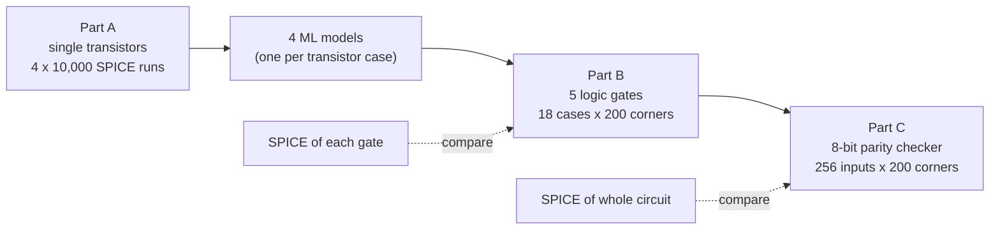
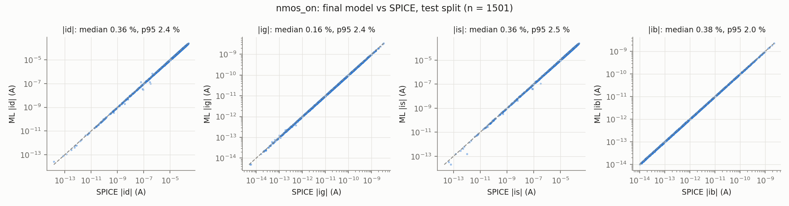
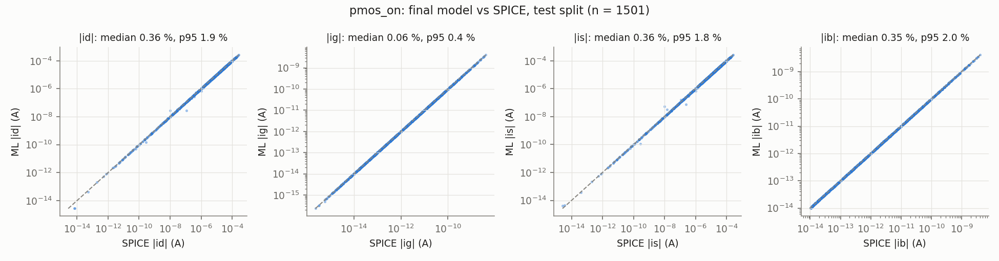
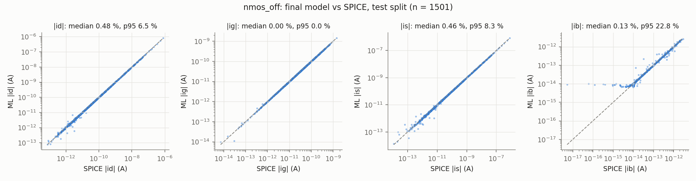
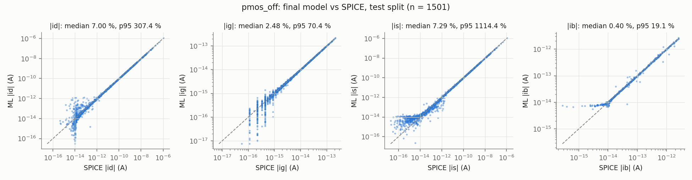
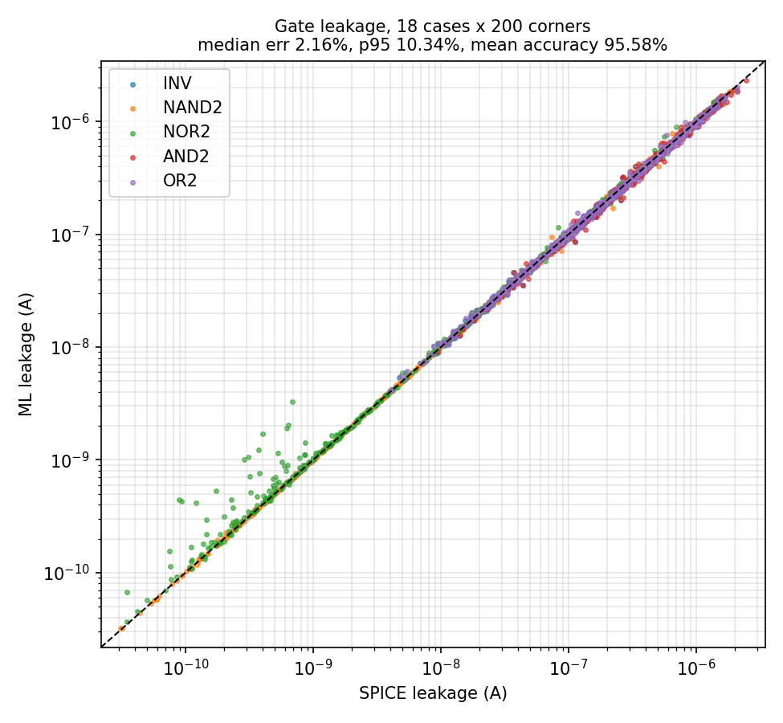
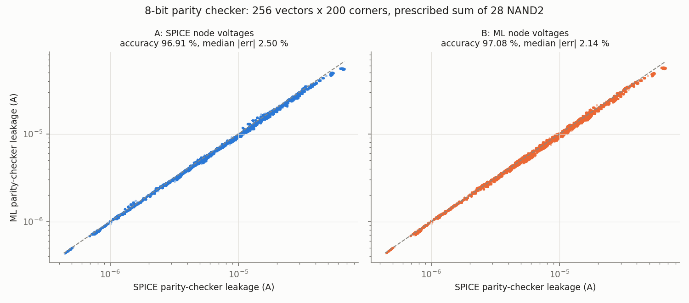

# Project Guide: ML-Driven PVT-Aware Leakage Estimation

This guide explains the whole project in one place:
- what the assignment asked for
- the background you need to follow it
- what was built and how
- every result, with the plots and how to read them
- what went wrong along the way and how it was fixed
- what is still left to do

Read it top to bottom the first time. Later, use the table of contents to jump around.

**Assignment:** 16 nm HP model · VDD = 0.9 V · test circuit = 8-bit parity checker.
**Simulator:** ngspice-36 on Ubuntu 22.04 · Python 3.10 · scikit-learn 1.7.

---

## Contents
1. [The project in one page](#1-the-project-in-one-page)
2. [Background concepts](#2-background-concepts)
3. [What the assignment asks for, and status](#3-what-the-assignment-asks-for-and-status)
4. [Part A1: Generating transistor data](#4-part-a1-generating-transistor-data)
5. [Part A2: Training the transistor models](#5-part-a2-training-the-transistor-models)
6. [Part B: Logic gates](#6-part-b-logic-gates)
7. [Part C: The 8-bit parity checker](#7-part-c-the-8-bit-parity-checker)
8. [Where the errors come from (error analysis)](#8-where-the-errors-come-from-error-analysis)
9. [What went wrong during the project, and the fixes](#9-what-went-wrong-during-the-project-and-the-fixes)
10. [Assumptions we made](#10-assumptions-we-made)
11. [What is left to do](#11-what-is-left-to-do)
12. [Repository map and how to rerun](#12-repository-map-and-how-to-rerun)
13. [Glossary](#13-glossary)

---

## 1. The project in one page

**The problem.** A chip draws current even when it is doing nothing; this is **leakage**. In a 16 nm chip, leakage is a large share of total power. It also changes a lot with:
- **P**rocess: tiny manufacturing differences between transistors
- **V**oltage: the supply varies by about ±10 %
- **T**emperature: −40 °C to 125 °C

Together these are called **PVT variation**. The accurate way to measure leakage is **SPICE** circuit simulation, which is slow for large circuits and many PVT conditions.

**The idea.**
1. Run SPICE only on *single transistors*.
2. Train machine-learning (ML) models that predict a transistor's currents.
3. Predict the leakage of *whole circuits* by combining those transistor predictions, with no further SPICE needed.
4. Check every ML prediction against SPICE to see how accurate the idea is.

**Three levels, each built on the one before:**



**Final results at a glance:**

| Level | Median error | Mean accuracy | Bias |
|---|---|---|---|
| Transistor models: NMOS ON / NMOS OFF / PMOS ON | 0.37–0.49 % | – | – |
| Transistor model: PMOS OFF | 5.6 % overall (~1 % in the region gates use) | – | – |
| **Gates** (3,600 comparisons) | **2.2 %** | **95.6 %** | −0.2 % |
| **Parity checker** (51,200 comparisons) | **4.1 %** | **95.3 %** | −3.7 % |

The TA's target was "up to 99 % mean accuracy" (TA slides: R² > 0.99, error < 1 %). We reach 95–96 %, with the best gate cases at 99 %. Section 8 explains exactly where the remaining error comes from.

---

## 2. Background concepts

### 2.1 Transistors, ON and OFF
A MOSFET has four terminals: **drain (d), gate (g), source (s) and body (b)**.
- The gate voltage switches the transistor ON (it conducts between d and s) or OFF (it is supposed to block).
- **NMOS** is ON when its gate is at VDD; **PMOS** is ON when its gate is at 0.

The project uses four transistor **cases**, defined by the gate and body voltages:

| Case | Gate | Body | Drain, source |
|---|---|---|---|
| NMOS ON | VDD | 0 | random in 0…VDD |
| NMOS OFF | 0 | 0 | random in 0…VDD |
| PMOS ON | 0 | VDD | random in 0…VDD |
| PMOS OFF | VDD | VDD | random in 0…VDD |

### 2.2 Where leakage comes from
Even an OFF transistor passes small currents:

| Mechanism | What it is | Typical size here |
|---|---|---|
| **Sub-threshold** (channel) leakage | Current through the "closed" channel. The biggest one. | 10⁻¹¹ to 10⁻⁶ A |
| **Gate tunnelling** | Electrons tunnel through the ~1 nm gate oxide | 10⁻¹⁵ (PMOS) to 10⁻⁹ A (NMOS) |
| **Junction / body** leakage | Reverse-biased diodes between drain/source and body | ~10⁻¹⁴ A |
| **GIDL** | Gate-induced drain leakage at high drain-gate voltage | small here |

The model file has all of these switched on (`igcmod=1`, `igbmod=1`, `diomod=1`, `agidl`…).

### 2.3 Terminal currents
For each transistor we record four currents, **Id, Ig, Is, Ib**: one flowing out of (or into) each terminal. Charge is conserved, so they always sum to zero (Kirchhoff's current law, **KCL**): `Id + Ig + Is + Ib = 0`.

**Sign convention.** We store the raw ngspice source currents. Positive means current flowing *out* of the transistor terminal. This matches the TA's sample database.

### 2.4 Corners
A **corner** is one random PVT condition: one VDD, one temperature, one set of the five process parameters for all NMOS, and another set for all PMOS. We draw **200 corners** once and use the same 200 for every gate and for the parity checker, so all comparisons are like-for-like.

### 2.5 How accuracy is measured
For each comparison:

```
error = (ML − SPICE) / SPICE            (relative error, e.g. 0.02 = 2 %)
```

| Metric | Meaning |
|---|---|
| **Median error** | Half of all comparisons are better than this |
| **p95 error** | 95 % of comparisons are better than this (the "bad tail") |
| **Bias** | Median *signed* error. Negative means ML predicts too low on average. |
| **Mean accuracy** | 100 % − average of \|error\| |
| **R²** | How much of the variation the model explains (1.0 = perfect), computed on log₁₀\|I\| because currents span 13 orders of magnitude |

### 2.6 Parity plots
Most result figures are **parity plots**: SPICE value on the x-axis, ML value on the y-axis, both on log scales. A perfect model puts every point on the dashed diagonal line. Points *above* the line are over-predictions; points *below* are under-predictions.

---

## 3. What the assignment asks for, and status

### 3.1 Our assigned values

| Item | Value |
|---|---|
| Model file | `16nm_HP.pm` (PTM 16 nm high-performance, BSIM4) |
| Nominal VDD | 0.9 V (sampled 0.81–0.99 V) |
| Channel length | 16 nm |
| Widths | 16–128 nm (1–8 × Lmin) |
| Temperature | −40 to 125 °C |
| Process parameters | vth0, toxe, ndep, u0, xj, each nominal ±10 % |
| Test circuit | 8-bit parity checker |

Nominal process parameters from the model file:

| Parameter | NMOS | PMOS | Meaning |
|---|---|---|---|
| vth0 | 0.47965 V | −0.43121 V | threshold voltage |
| toxe | 0.95 nm | 1.0 nm | gate oxide thickness |
| ndep | 7.0×10¹⁸ | 5.5×10¹⁸ | channel doping |
| u0 | 0.03 | 0.006 | mobility |
| xj | 5 nm | 5 nm | junction depth |

### 3.2 Deliverables checklist

| # | Deliverable (from the spec) | Where | Status |
|---|---|---|---|
| 1 | 4 datasets × 10,000 rows, exact columns | `data/*.csv` | ✅ |
| 2 | Example netlists: 4 transistor, 5 gate, 1 circuit | `netlists/` | ✅ |
| 3 | KCL check + 3 trend plots | `results/kcl_check.csv`, `figures/trend_*.png` | ✅ |
| 4 | Model comparison: 4 model types × 4 cases (R², median, p95, validation set) | `results/model_comparison_val.csv` | ✅ |
| 5 | Chosen models: test errors, predicted-vs-SPICE plots, 4 saved model files | `results/chosen_models_test.csv`, `figures/pred_vs_spice_*.png`, `models_trained/` | ✅ |
| 6 | Gate results table (18 cases) | `results/gate_results.csv` | ✅ |
| 7 | Gate parity plot | `figures/gate_parity.png` | ✅ |
| 8 | Test-circuit results + parity plot | `results/circuit_results.csv`, `figures/circuit_parity.png` | ✅ |
| 9 | Code that regenerates everything, with fixed seeds | `run_all.sh` + `01_…08_*.py` | ✅ (a final clean rerun is still planned) |
| 10 | Typed report | – | ⏳ **not written yet** |

Every netlist contains the required `.options gmin=1e-18 abstol=1e-18 reltol=1e-6 vntol=1e-9`, and every single-transistor netlist has one voltage source per terminal, as required.

---

## 4. Part A1: Generating transistor data

### 4.1 What we did
For each of the 4 cases we created **10,000 random samples** (40,000 in total). Each sample is drawn in this order, all uniform and independent:
1. VDD in 0.81–0.99 V (first, because the next ranges depend on it)
2. drain voltage Vd and source voltage Vs, each in 0…VDD
3. width W in 16–128 nm, and temperature in −40…125 °C
4. the 5 process parameters, each nominal ±10 %

Gate and body voltages are fixed by the case (table in 2.1).

Each sample becomes its own SPICE netlist: the model card with that sample's parameter values substituted, one voltage source per terminal, and the required options. Example: [`netlists/nmos_on_example.cir`](netlists/nmos_on_example.cir).

To keep it fast, one ngspice process runs hundreds of circuits back to back, with 4 processes in parallel. All 40,000 simulations take about 2 minutes. No simulation failed.

### 4.2 Data check 1: Kirchhoff's law
The four currents must sum to zero. We checked every one of the 40,000 samples:

| Case | Worst \|Id+Ig+Is+Ib\| | Median |
|---|---|---|
| NMOS ON | 1.0×10⁻¹⁴ A | 2×10⁻¹⁶ A |
| NMOS OFF | 8.2×10⁻¹⁸ A | 5×10⁻²² A |
| PMOS ON | 9.9×10⁻¹⁵ A | 8×10⁻¹⁷ A |
| PMOS OFF | 1.3×10⁻¹⁵ A | 8×10⁻¹⁷ A |

All residuals are at about 10⁻¹⁵ A or below. That is ngspice's numerical resolution here: currents are resolved in steps of about 2×10⁻¹⁶ A. **The data is physically consistent.**

### 4.3 Data check 2: trend plots
Each figure has two panels. The **left panel** is the random dataset (noisy, because every other parameter also varies). The **right panel** is a clean SPICE sweep with everything at nominal, so the trend itself is visible.

**OFF current vs temperature**


OFF current rises steadily with temperature: about 6× for NMOS and 3× for PMOS from −40 to 125 °C. This is expected, because the sub-threshold current depends exponentially on kT/q and the threshold voltage falls with temperature.

**OFF current vs threshold voltage vth0**


On a log scale the lines are straight: the OFF current falls **exponentially** as |vth0| rises, roughly 10× per 0.1 V. The dashed lines (125 °C) sit above the solid ones (27 °C). This is the textbook sub-threshold behaviour, I ∝ exp(−Vth / (n·kT/q)).

**Gate current vs oxide thickness toxe**


The gate current falls exponentially as the oxide gets thicker, because tunnelling through a thinner barrier is exponentially easier. NMOS gate current is about 10× larger than PMOS, since electrons tunnel more easily than holes.

All three trends match device physics, so the data can be trusted for training.

---

## 5. Part A2: Training the transistor models

### 5.1 The task
For each case, learn a function:

```
(VDD, T, W, Vd, Vs, Vg, Vb, vth0, toxe, ndep, u0, xj)  →  (Id, Ig, Is, Ib)
```

Data split: **70 % training (7,000), 15 % validation (1,500), 15 % test (1,500)**, with a fixed random seed.
- The **training** set is used to fit the models.
- The **validation** set is used to choose the best model type.
- The **test** set is only used at the very end, to report honest accuracy on data never seen before.

### 5.2 Why this is hard
1. **Huge range.** Currents span about **13 orders of magnitude** (10⁻¹⁷ to 10⁻⁴ A).
2. **Sign changes.** Some currents change sign depending on the voltages.
3. **Several mechanisms at once.** The current is a sum of several mechanisms (section 2.2), and which one dominates changes with the voltages.

### 5.3 The techniques we used (and why)

| # | Technique | What it does | Why |
|---|---|---|---|
| 1 | **Log target** | Predict ln(\|I\| / W) instead of I | Turns 13 decades into a manageable range. An error of 0.01 in the log is ~1 % in current. Dividing by W helps because leakage scales with width. |
| 2 | **Symmetric "hi/lo" frame** | Always call the higher of (Vd, Vs) "hi" and the lower "lo" | A MOSFET is symmetric. In this frame almost every current always flows the same way, so its sign is known. |
| 3 | **Kirchhoff for the mixed-sign current** | The one current that can still change sign is not learned: it is computed as −(sum of the other three) | Avoids learning a zero crossing, and makes every prediction satisfy KCL exactly. |
| 4 | **Physics inputs** | Feed Vgs/Vt, Vgd/Vt, Vds/Vt, ln(1−e^(−Vds/Vt)), \|vth0\|/Vt (Vt = kT/q) | These are the variables in the sub-threshold current equation, so the model does not have to discover exponentials from scratch. |
| 5 | **Noise floor** | Ignore currents below 3×10⁻¹⁵ A when training the GP | Below that, the SPICE values are partly numerical noise. Their logarithm is random and would poison the fit. |
| 6 | **Two experts for OFF devices** | Separate models for the "channel-dominated" and "junction/gate-dominated" regimes. The split point is found automatically from the data. | The change-over between regimes is a sharp bend that one smooth model cannot follow (details in section 9). |
| 7 | **Clamp on ln(1−e^(−Vds/Vt))** | Limit that input at Vds = 2 mV | It heads to −∞ as Vds → 0. ON transistors inside gates sit at µV–mV, far outside the training data (section 9). |

### 5.4 The four model types compared

| Model type | Main settings |
|---|---|
| **Polynomial ridge regression** | degree-3 polynomial of the inputs, ridge penalty 10⁻⁴ |
| **LightGBM** (gradient-boosted trees) | 5,000 trees, learning rate 0.02, 15 leaves |
| **MLP** (neural network) | 3 hidden layers × 64 tanh units, Adam, early stopping |
| **Gaussian process (GP)** | ARD RBF kernel + linear mean; settings tuned on 2,000 points, then exact GP on all training points |

A **Gaussian process** predicts a new point as a weighted blend of nearby training points, where "nearby" is learned separately for each input. It is excellent for smooth, low-noise functions like these, and it is exact rather than approximate.

### 5.5 Model comparison table (validation set)
The numbers are median relative error (%) per terminal current, and the average of the four:

| Case | Model | Id | Ig | Is | Ib | **Avg** |
|---|---|---|---|---|---|---|
| NMOS ON | Poly ridge | 12.3 | 7.0 | 12.3 | 13.1 | 11.2 |
| | LightGBM | 3.6 | 5.8 | 3.6 | 8.6 | 5.4 |
| | MLP | 2.8 | 3.6 | 2.9 | 3.1 | 3.1 |
| | **GP** | **0.52** | **0.37** | **0.50** | **0.49** | **0.47** |
| NMOS OFF | Poly ridge | 28.6 | 1.1 | 26.4 | 21.1 | 19.3 |
| | LightGBM | 9.0 | 3.3 | 9.0 | 1.1 | 5.6 |
| | MLP | 3.5 | 1.6 | 3.5 | 1.7 | 2.6 |
| | **GP** | **0.66** | **0.00** | **0.62** | **0.18** | **0.37** |
| PMOS ON | Poly ridge | 10.6 | 10.7 | 10.6 | 13.6 | 11.4 |
| | LightGBM | 3.4 | 10.3 | 3.4 | 9.1 | 6.5 |
| | MLP | 5.5 | 2.8 | 5.5 | 3.2 | 4.3 |
| | **GP** | **0.54** | **0.10** | **0.52** | **0.42** | **0.40** |
| PMOS OFF | Poly ridge | 14.4 | 51.9 | 16.2 | 20.1 | 25.6 |
| | LightGBM | 19.1 | 35.0 | 19.5 | 1.4 | 18.8 |
| | MLP | 16.2 | 20.2 | 17.4 | 5.2 | 14.8 |
| | **GP** | **9.6** | **2.6** | **9.7** | **0.50** | **5.6** |

The full table, including R² and p95, is in `results/model_comparison_val.csv`.

**Why the GP was chosen.** It wins every case by a wide margin, 5–10× better than the next best (MLP). The GP is also exact for smooth functions, and transistor currents are smooth functions of the inputs.

### 5.6 Chosen models on the test set

| Case | Id | Ig | Is | Ib | R² (log\|Id\|) |
|---|---|---|---|---|---|
| NMOS ON | 0.54 % | 0.41 % | 0.53 % | 0.48 % | 0.999 |
| NMOS OFF | 0.67 % | 0.00 % | 0.65 % | 0.19 % | 0.998 |
| PMOS ON | 0.48 % | 0.11 % | 0.49 % | 0.42 % | 0.998 |
| PMOS OFF | 10.4 % | 2.5 % | 10.9 % | 0.47 % | 0.959 |

### 5.7 Predicted-vs-SPICE plots (test set)
Each figure has 4 panels (Id, Ig, Is, Ib); every dot is one test sample.

**NMOS ON**: every current sits tightly on the diagonal across all decades.



**PMOS ON**: equally tight.



**NMOS OFF**:
- Id, Is and Ig sit on the line from 10⁻¹³ to 10⁻⁶ A.
- Ib flattens out around 10⁻¹⁴ A. Below that, SPICE's own values are noise, so the model sensibly predicts the floor.



**PMOS OFF** (how to read it): this looks the worst, but look *where* the scatter is.
- **Above about 10⁻¹² A, every panel is on the line.** That is the range that matters for gate leakage (10⁻¹⁰ to 10⁻⁶ A).
- **The scatter is entirely below about 10⁻¹³ A**, where the current falls to the junction floor (~10⁻¹⁴ A) and SPICE's ~2×10⁻¹⁶ A resolution steps make the data itself noisy. In the Ig panel you can even see those steps: vertical stripes of SPICE values at exact multiples of 2.2×10⁻¹⁶ A.
- Those tiny-current samples are a large share of the PMOS OFF data, which is why its *median* error is high even though the model is accurate where it counts.
- The Ig panel shows "p95 nan%" because some SPICE gate currents are exactly 0, so relative error is undefined.



---

## 6. Part B: Logic gates

### 6.1 The gates
Standard static CMOS gates. AND2 = NAND2 + INV and OR2 = NOR2 + INV, each simulated as one complete gate.

| Gate | Inputs | Internal node(s) recorded |
|---|---|---|
| INV | A = 0, 1 | – |
| NAND2 | AB = 00, 01, 10, 11 | x (between the two series NMOS) |
| NOR2 | AB = 00, 01, 10, 11 | y (between the two series PMOS) |
| AND2 | AB = 00…11 | x, and the NAND output nd |
| OR2 | AB = 00…11 | y, and the NOR output nr |

That gives **18 gate/input cases × 200 corners = 3,600 SPICE simulations**, plus the same 3,600 ML predictions.

**Transistor sizes.** These follow the TA's AND2 example: INV PMOS = 2× NMOS, stacked transistors 2×. The unit width is **24 nm** (1.5 × Lmin), which keeps every transistor (24–96 nm) strictly inside the trained range of 16–128 nm.

| Gate | NMOS width | PMOS width |
|---|---|---|
| INV | 24 nm | 48 nm |
| NAND2 | 48 nm (series) | 48 nm (parallel) |
| NOR2 | 24 nm (parallel) | 96 nm (series) |

Example netlist: [`netlists/gate_NAND2.cir`](netlists/gate_NAND2.cir).

### 6.2 SPICE reference
- **Inputs** are ideal sources at exactly 0 or VDD.
- **Leakage definition:** the total current drawn from everything at logic 1:

  ```
  I_leak = −( I(Vdd) + sum of I(V_input) for inputs held at 1 )
  ```

  The inputs held at 1 also push gate-tunnelling current into the gate, so they are included.
- **Sanity check:** we also measured the current returning through ground. It agrees with the supply side within 0.002 %, so the circuit currents balance.

### 6.3 ML prediction: how gate leakage is computed from transistor models
As the spec prescribes, the ML prediction takes the **SPICE-recorded node voltages** (output, x, y, nd, nr) and works out each transistor's four terminal voltages. Each transistor's gate level selects its ON or OFF model, and the model predicts its four terminal currents.

**The tricky part: adding the currents up correctly.** In a leaking gate, the ON transistors have only microvolts to millivolts across them. Their channel current is tiny and hard to predict, because the training data almost never has such a small Vds. So we use a **cut-set** method based on Kirchhoff's law:
1. Split all nodes into a **logic-1 group** (VDD rail, inputs at 1, nodes driven high) and a **logic-0 group**.
2. By KCL, the leakage equals the net current flowing from the logic-1 group into the logic-0 group.
3. A transistor whose drain and source are in the **same** group (every ON transistor) can only pass current across the split through its **gate and body**, so only Ig and Ib are used.
4. A transistor whose drain and source are in **different** groups (an OFF transistor holding the voltage) contributes its currents on the logic-1 side.

**Example: inverter with input A = 1** (output ≈ 0):
- **PMOS** (gate = A = 1, source = VDD, drain = out ≈ 0) is **OFF** and straddles the split. It contributes its sub-threshold leakage from VDD to the output, about 2×10⁻⁷ A.
- **NMOS** (gate = A = 1, drain = out ≈ 0, source = 0) is **ON**. Drain and source are both in the logic-0 group, so it contributes only its gate current (input → channel), about 5×10⁻¹¹ A.
- **Total ≈ PMOS sub-threshold + NMOS gate tunnelling.**

This is exactly the TA's slide formula "leakage = I_sub + I_gate + I_body", made rigorous.

**Floating stack nodes.** When two stacked transistors are both OFF (NAND2 `00`, NOR2 `11`), the node between them floats at an in-between voltage. Either group works by KCL. We put it on the output's side, so the transistor connected to the supply rail is the one crossing the split, which is the regime the models predict best.

### 6.4 ML internal node voltages
The spec asks for internal node voltages "from both" SPICE and ML. We also **solve** each internal node voltage with the ML models: find the voltage at which the predicted currents into the node sum to zero, by bisection. The ML node voltages agree with SPICE within **0.003–1.2 mV** (median per case); see `results/gate_node_voltages.csv`. For example, NAND2 `00`: x = 0.15090 V (SPICE) vs 0.15096 V (ML).

### 6.5 Gate results (deliverable 6)

| Gate | Input | SPICE median | ML median | Bias | Median error | p95 error | Accuracy |
|---|---|---|---|---|---|---|---|
| INV | 0 | 5.01e-08 A | 5.27e-08 A | +1.1 % | 2.5 % | 11.2 % | 96.3 % |
| INV | 1 | 1.95e-07 A | 1.86e-07 A | −2.4 % | 3.5 % | 10.1 % | 95.8 % |
| NAND2 | 00 | 5.60e-10 A | 5.60e-10 A | +0.3 % | **0.48 %** | 3.0 % | **99.0 %** |
| NAND2 | 01 | 1.14e-07 A | 1.15e-07 A | −0.2 % | **0.84 %** | 4.9 % | 98.6 % |
| NAND2 | 10 | 1.72e-08 A | 1.74e-08 A | +0.4 % | **0.64 %** | 2.0 % | **99.2 %** |
| NAND2 | 11 | 3.83e-07 A | 3.65e-07 A | −2.4 % | 3.5 % | 10.0 % | 95.9 % |
| NOR2 | 00 | 9.98e-08 A | 1.05e-07 A | +1.1 % | 2.5 % | 11.2 % | 96.3 % |
| NOR2 | 01 | 3.90e-07 A | 3.94e-07 A | +1.0 % | 1.9 % | 10.8 % | 96.7 % |
| NOR2 | 10 | 3.65e-08 A | 3.70e-08 A | +0.1 % | **0.80 %** | 3.4 % | 98.8 % |
| NOR2 | 11 | 6.22e-10 A | 7.44e-10 A | +2.7 % | 2.9 % | 205 % | 73.3 % |
| AND2 | 00 | 1.96e-07 A | 1.87e-07 A | −2.3 % | 3.5 % | 10.1 % | 95.9 % |
| AND2 | 01 | 3.63e-07 A | 3.50e-07 A | −3.0 % | 3.6 % | 9.6 % | 95.8 % |
| AND2 | 10 | 2.18e-07 A | 2.11e-07 A | −2.5 % | 3.4 % | 9.7 % | 96.0 % |
| AND2 | 11 | 4.61e-07 A | 4.43e-07 A | −2.9 % | 3.5 % | 10.1 % | 95.9 % |
| OR2 | 00 | 3.46e-07 A | 3.37e-07 A | −2.9 % | 3.5 % | 9.3 % | 96.0 % |
| OR2 | 01 | 4.65e-07 A | 4.58e-07 A | −0.3 % | 1.7 % | 8.7 % | 97.0 % |
| OR2 | 10 | 1.09e-07 A | 1.08e-07 A | −0.2 % | 1.5 % | 7.1 % | 97.8 % |
| OR2 | 11 | 5.23e-08 A | 5.48e-08 A | +1.1 % | 2.5 % | 10.7 % | 96.3 % |
| **All** | | 1.22e-07 A | 1.23e-07 A | **−0.2 %** | **2.2 %** | **10.3 %** | **95.6 %** |

**How to read it:**
- **Most accurate (< 1 %):** NAND2 `00`, `01`, `10` and NOR2 `10`. In these, the leakage is carried by OFF **NMOS** transistors, or by the rail-connected transistor of a stack, where the models are best.
- **Systematic −2 to −3 %:** INV `1`, NAND2 `11`, all AND2 cases and OR2 `00`. In every one of these, an **OFF PMOS holds the full supply voltage** (source at VDD, drain at 0). That is the corner of the PMOS OFF input space with the fewest training samples (section 8).
- **NOR2 `11`:** a good median (2.9 %), but a wide tail (p95 205 %). Its leakage is tiny (6×10⁻¹⁰ A, two OFF PMOS in series), so small absolute errors become large relative ones at some corners.
- **Pattern dependence:** leakage varies about 700× with the input pattern (NAND2 `00` vs `11`), the classic **stacking effect**. Two OFF transistors in series leak far less than one, because the middle node rises and reverse-biases the upper transistor. Both SPICE and ML capture this.

### 6.6 Gate parity plot (deliverable 7)



All 3,600 points over four decades (3×10⁻¹¹ to 2×10⁻⁶ A) lie on or very close to the diagonal. The only visible scatter is a handful of **NOR2 points at low leakage (10⁻¹⁰ to 10⁻⁹ A)** above the line: the NOR2 `11` tail described above.

---

## 7. Part C: The 8-bit parity checker

### 7.1 The circuit
- An 8-bit parity checker outputs 1 when an **odd** number of its 8 inputs is 1: P = D0 ⊕ D1 ⊕ … ⊕ D7.
- It is a balanced tree of **7 XOR gates** (4 → 2 → 1).
- Only INV/NAND2/NOR2/AND2/OR2 models are allowed, so each XOR is built from **4 NAND2** (the classic construction):

  ```
  n1 = NAND(a, b);   n2 = NAND(a, n1);   n3 = NAND(b, n1);   out = NAND(n2, n3)
  ```

- In total: **28 NAND2 gates, 112 transistors.**
- There are 2⁸ = **256 input vectors**, and at 200 corners that makes **51,200 SPICE simulations**. Netlist: [`netlists/parity8.cir`](netlists/parity8.cir).

### 7.2 SPICE reference
One complete transistor-level netlist per corner, with all 256 input vectors applied in turn. Results:
- **No failures and no logic errors:** in all 51,200 runs the output had the correct parity.
- **Sanity check:** supply and ground currents agree within 10⁻⁷ (relative).
- **Leakage:** median 5.4 µA, ranging from 0.44 to 31 µA depending on corner and input.

### 7.3 ML prediction (hierarchical)
For each input vector:
1. A **logic simulation** finds the two inputs of each of the 28 NAND2 gates. For example, input 00000000 gives NAND2 patterns 00, 01, 01, 11 in the first XOR.
2. For each NAND2, look up its **Part B ML leakage** for that pattern at that corner.
3. **Add the 28 values.**

This ignores two effects, as the spec says:
- gate inputs are assumed to be at exactly 0 or VDD
- loading between gates is ignored

So "expect the accuracy to be somewhat lower than at the gate level".

### 7.4 Results (deliverable 8)

| Circuit | n | SPICE median | ML median | Bias | Median error | p95 error | Accuracy |
|---|---|---|---|---|---|---|---|
| 8-bit parity | 51,200 | 5.38 µA | 5.20 µA | **−3.7 %** | **4.1 %** | **11.2 %** | **95.3 %** |

The accuracy hardly depends on the number of 1s in the input (median error 4.0–4.8 % for every count; `results/circuit_results_by_ones.csv`).



**How to read it:**
- The points follow the diagonal over two decades (0.4–30 µA), but sit slightly **below** it (ML a little low).
- The colour shows **temperature**. Hot corners (red) lie further below the line than cold ones (blue); section 8 explains why.

**Compared with gate level:** median error 4.1 % vs 2.2 %, and bias −3.7 % vs −0.2 %.
- The gate-level PMOS bias carries over, because each NAND2 `11` has an OFF PMOS at full Vds.
- The circuit-only effects add about 1.3 % more on top.

---

## 8. Where the errors come from (error analysis)

### 8.1 By transistor case
NMOS ON, NMOS OFF and PMOS ON are all below 0.7 % median error. **PMOS OFF is the weakest model**, for two reasons:
1. **Most of its samples are in the floor region.** The PMOS OFF channel current collapses about 10× per 50 mV as the source moves away from VDD, so most random samples sit in the junction/noise floor (~10⁻¹⁴ A), where SPICE itself is noisy (section 5.7).
2. **Gates use the edge of its input space.** Gates use PMOS OFF with source = VDD and drain = 0. That is a corner of the sampled range, where only about 1 % of training samples fall.

### 8.2 By gate and input
- **Best:** the NMOS-dominated cases (NAND2 `00`/`01`/`10`, NOR2 `10`), at 0.5–0.8 %.
- **Weakest:** the PMOS-OFF-at-full-Vds cases (INV `1`, NAND2 `11`, AND2, OR2 `00`), at about 3.5 % with −2.4 % bias.
- **Widest tail:** NOR2 `11`, where the leakage is tiny.

### 8.3 By corner condition
Median signed error (bias) / median \|error\| for each range of the corner parameter:

| Corner condition | Gates | Parity checker |
|---|---|---|
| T −40…0 °C | +0.7 % / 3.3 % | −1.5 % / 2.9 % |
| T 0…40 °C | 0.0 % / 1.9 % | −1.7 % / 2.3 % |
| T 40…80 °C | −0.7 % / 1.4 % | −4.4 % / 4.4 % |
| T 80…125 °C | −1.0 % / 2.5 % | **−6.4 % / 6.4 %** |
| VDD 0.81–0.855 V | −0.4 % / 1.9 % | −3.6 % / 3.6 % |
| VDD 0.945–0.99 V | +0.3 % / 3.1 % | −4.0 % / 5.4 % |

Process parameters (vth0 etc.) show no strong trend: the bias stays within about ±1 % across vth0 quartiles for gates, and between −2.8 and −5.2 % for the parity checker.

**The clearest effect is temperature at circuit level.** The parity checker's underestimate grows from −1.5 % (cold) to −6.4 % (hot), while gates alone barely change.

**Likely reason.** Inside the full circuit, a logic "1" produced by another gate sits slightly *below* VDD, because leakage flows through the driving gate's ON PMOS. The gap is larger when hot, because leakage is larger then.
- An **OFF PMOS whose gate receives that slightly-low "1"** is not fully off.
- Its leakage rises exponentially with the gap.
- The gate-level model assumes ideal inputs at exactly VDD, so it misses this extra leakage, and more so at high temperature.

This is exactly the "inputs at exactly 0/VDD, no loading" assumption the spec warns about. It is listed in `future.md` for a fuller analysis.

---

## 9. What went wrong during the project, and the fixes
This section is useful for the report's "Models" and "Error analysis" sections and for a viva.

| Stage | Symptom | Root cause | Fix | Effect |
|---|---|---|---|---|
| 1 | First models 10–60 % error | Learning signed currents directly, including zero crossings | Log target, hi/lo frame, mixed-sign current from KCL | Large improvement |
| 2 | Trees / MLP stuck at 3–5 % | Sum of exponentials in different variables is hard for those models | Gaussian process with physics inputs | NMOS OFF hardest current 4.2 % → 0.54 % |
| 3 | PMOS OFF 14 %; gates 14 % low; parity 13 % low | One smooth GP fitting two regimes: channel leakage and the junction floor | Ignore sub-noise currents; **two experts** split where the channel/floor ratio drops below 10 (found automatically: 30 % of VDD for PMOS, 12.5 % for NMOS) | PMOS OFF at the gate point: −18 % → +0.2 % bias |
| 4 | NOR2 `11` +61 %, NAND2 `00` +6 % | The input ln(1−e^(−Vds/Vt)) → −∞ for ON transistors at µV Vds, so the GP extrapolated wildly (ON gate current +268 %) | Clamp that input at Vds = 2 mV | NOR2 `11` → 2.9 %, NAND2 `00` → 0.48 % |
| Overall | | | | Gates 88 % → 95.6 %; parity 86 % → 95.3 % |

How problems 3 and 4 were found: each transistor model was tested **exactly at the voltages it sees inside the gates**, against fresh single-transistor SPICE runs. This pinpointed which model and which current was wrong, instead of guessing.

---

## 10. Assumptions we made
The spec left these open, so we chose. ⚠️ marks the ones worth confirming with the TA:

| # | Topic | Our choice |
|---|---|---|
| ⚠️ 1 | Gate transistor widths | 24 nm unit; INV 1/2, NAND2 2/2, NOR2 1/4 units |
| ⚠️ 2 | Leakage definition | Current from VDD **plus** inputs held at 1 |
| ⚠️ 3 | "Accuracy" | 100 % − mean \|relative error\| |
| ⚠️ 4 | Parity structure | 7 XOR2 from 4 NAND2 each, odd parity, no output inverter |
| 5 | Current sign | Raw ngspice source currents (positive = out of the device), as in the TA sample |
| 6 | Process variation | Only the 5 listed parameters vary; related ones (e.g. toxm) stay at nominal |
| 7 | Corners | One NMOS draw and one PMOS draw per corner, shared by all transistors, also in the parity checker |
| 8 | Gate inputs | Ideal sources at 0 / VDD; no output load |
| 9 | R² | Computed on log₁₀\|I\| |
| 10 | Seeds | data 2026, split 42, models 7, corners 1234 |

---

## 11. What is left to do
The full list, with details, is in [`future.md`](future.md). In short:
1. **Write the report** (the only missing deliverable). All the material is in this guide.
2. Finish the error analysis with plots of error vs corner parameters (section 8.3 has the numbers).
3. Do a clean end-to-end rerun of `./run_all.sh` to prove reproducibility (~2.5 h).
4. Confirm the ⚠️ assumptions with the TA.
5. Optional: a dataset-size study; more PMOS OFF accuracy (needs approval, because of the 10,000-row rule).

---

## 12. Repository map and how to rerun

```
DVD/
├── config.py                  assignment values, ranges, seeds, paths
├── spice_utils.py             model-card editing, batched/parallel ngspice
├── ml_utils.py                features, 4 model types, GP, two-expert transistor model
├── circuits.py                gate & parity netlists, ML gate leakage (cut-set), node solver
├── 01_gen_transistor_data.py  Part A data           → data/*.csv
├── 02_data_check.py           KCL + trend plots     → results/kcl_check.csv, figures/trend_*
├── 03_train_models.py         4 types x 4 cases     → results/model_comparison_val.csv, models_trained/
├── 04_gen_corners.py          200 corners           → data/corners.csv
├── 05_gate_spice.py           gate SPICE            → results/gate_spice.csv
├── 06_gate_ml.py              gate ML + tables      → results/gate_results.csv, figures/gate_parity.png
├── 07_circuit_spice.py        parity SPICE          → results/circuit_spice.csv
├── 08_circuit_ml.py           parity ML + tables    → results/circuit_results.csv, figures/circuit_parity.png
├── run_all.sh                 runs the steps in order (logs in results/log_<step>.txt)
├── data/  netlists/  results/  figures/  models_trained/
├── README.md                  short technical summary
├── PROJECT_GUIDE.md           this document
└── future.md                  remaining work
```

To rerun, on the Linux machine:

```bash
cd ~/DVD
pip3 install --user numpy pandas scikit-learn scipy matplotlib joblib lightgbm
nohup ./run_all.sh > results/run_all.log 2>&1 < /dev/null &   # all 8 steps, ~2.5 h
./run_all.sh 3 6 8                                            # only retrain + re-evaluate
```

---

## 13. Glossary

| Term | Meaning |
|---|---|
| **BSIM4** | The industry-standard compact transistor model used in the model file (level 54) |
| **Corner** | One random draw of VDD, temperature and process parameters |
| **Cut-set (method)** | Computing total leakage as the current crossing between the logic-1 and logic-0 node groups |
| **DIBL** | Drain-induced barrier lowering: higher drain voltage lowers the barrier and increases OFF current |
| **Expert (model)** | One of two sub-models, each trained on one physical regime |
| **GIDL** | Gate-induced drain leakage |
| **GP** | Gaussian process regression |
| **KCL** | Kirchhoff's current law: the currents into a node (or device) sum to zero |
| **Leakage** | Static current drawn while the circuit is idle |
| **Lmin** | Minimum channel length = 16 nm here |
| **ngspice** | The open-source SPICE simulator used |
| **p95** | 95th percentile: 95 % of values are below it |
| **Parity plot** | ML vs SPICE scatter plot; perfect = on the diagonal |
| **PTM** | Predictive Technology Model, the source of the `.pm` model files |
| **PVT** | Process, voltage, temperature variation |
| **Stacking effect** | Series OFF transistors leak much less than a single one |
| **Sub-threshold leakage** | Channel current of an OFF transistor; exponential in gate voltage and temperature |
| **Vt (thermal voltage)** | kT/q ≈ 26 mV at room temperature |
